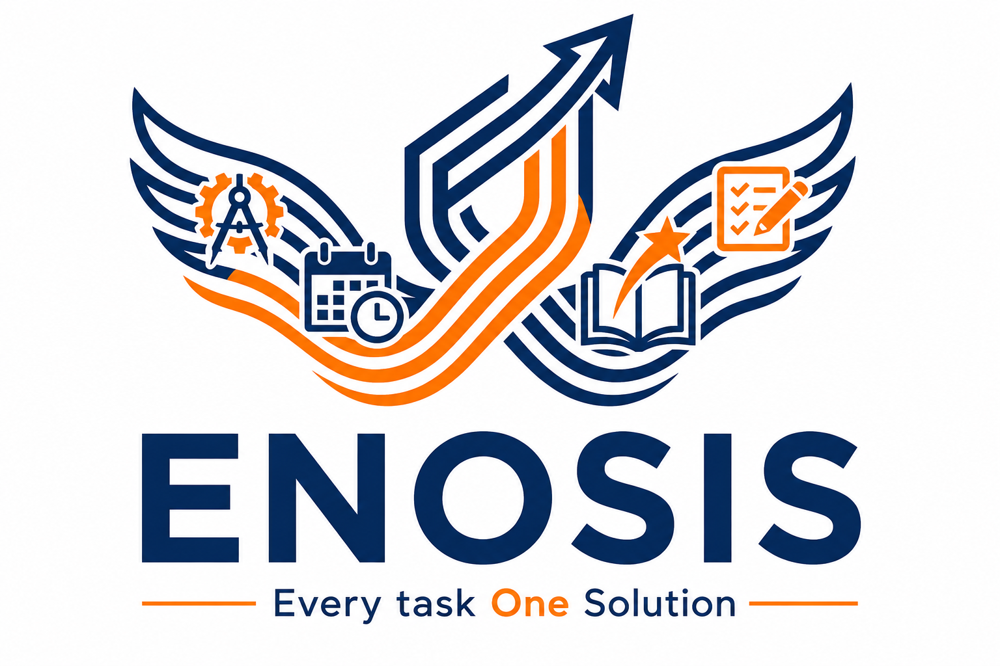
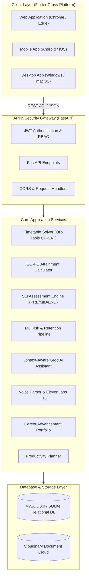

<div align="center">



# 🎓 ENOSIS
### *Every Task. One Solution.*

[](https://fastapi.tiangolo.com)
[](https://flutter.dev)
[](https://www.mysql.com)
[](https://developers.google.com/optimization)
[](https://www.docker.com)
[](backend/tests)

**ENOSIS** is a unified, intelligent academic operating system built for modern colleges and universities. It replaces fragmented spreadsheets, manual scheduling headaches, and disconnected accreditation paperwork with a single, responsive platform.

From automated mathematical timetable scheduling and NBA/NAAC-accredited outcome mapping to student learning intelligence, career tracking, and context-aware AI assistance — ENOSIS gives educators and administrators everything they need in one cohesive ecosystem.

---

[What is ENOSIS?](#-what-is-enosis-in-simple-words) • [Key Working Modules](#-key-working-modules) • [System Architecture](#-system-architecture) • [Quick Start](#-quick-start) • [API Directory](#-api-directory) • [Default Logins](#-default-development-accounts) • [Technology Stack](#-technology-stack)

---

</div>

## 💡 What is ENOSIS? (In Simple Words)

In most colleges today, managing academic operations is chaotic:
- **Timetable coordinators** spend weeks in Excel trying to fit dozens of classes, faculty members, and labs without double-booking rooms or teachers.
- **Faculty members** jump between different portals to check their schedules, plan their lectures, track curriculum outcomes, and record their professional achievements.
- **Accreditation teams** (NBA / NAAC) struggle to calculate complex Course Outcome (CO) and Program Outcome (PO) attainment matrices from disconnected assessment files.
- **Students at risk of failing or dropping out** are often noticed too late — after final exams are already over.

**ENOSIS solves all of this with one unified solution:**
1. 🗓️ **Generates Conflict-Free Timetables in Seconds**: Uses mathematical constraint programming (Google OR-Tools CP-SAT) to create mathematically clash-free schedules for all classes, teachers, and laboratories simultaneously.
2. 🎯 **Automates CO-PO Attainment & NBA/NAAC Reports**: Computes direct and indirect outcome attainment matrices and exports accreditation-ready spreadsheets instantly.
3. 📊 **Guides Student Learning (PRE → MID → END)**: Tracks student comprehension from day one through mid-semester to final outcomes, detecting learning barriers early.
4. 🧠 **Predicts Academic Risk with Machine Learning**: Proactively alerts faculty about students needing extra academic attention before semester exams.
5. ⚡ **Gives Faculty a Unified Daily Command Center**: A clean dashboard featuring today's live lecture schedule, personalized to-do tasks, institutional announcements, and career portfolios.
6. 🤖 **Provides an Institutional AI Assistant**: An intelligent assistant that understands your institution's courses, faculty profiles, and schedules to answer queries and parse voice commands.

---

## 🌟 Key Working Modules

### 1. 🗓️ Intelligent Timetable Optimization Engine (Google OR-Tools CP-SAT)
An industrial-grade constraint satisfaction engine that replaces manual timetable planning.
- **Zero-Clash Constraint Solving**: Enforces mathematical hard constraints guaranteeing zero faculty collisions, zero room overlaps, and zero division double-booking.
- **Division-Level Schedule Separation**: Intelligently schedules division lectures (e.g. TY-A, TY-B, TY-C) into separate, conflict-free periods even when taught by the exact same faculty member.
- **2-Hour Laboratory Blocks & Batch Splitting**: Automatically reserves consecutive periods in dedicated computer/electronics labs for smaller batches (B1, B2, B3) without crossing recess or lunch breaks.
- **Dynamic Room Allocation & Designated Home Classrooms**: Automatically assigns dedicated home classrooms for standard lectures and specialized laboratories for practical sessions.
- **Interactive Multi-View Explorer**: Real-time tabs to explore schedules by **Class Views**, **Faculty Views**, **Classrooms**, and **Labs**.
- **Interactive Drag-and-Drop Adjustment**: Drag slots directly on the timetable grid with instant conflict warnings and automatic local cascade resolution.
- **Interactive Slot-Locking Workbench**: Allows administrators to lock critical periods in advance, backed by a Groq AI Advisor that analyzes schedule feasibility.
- **Multi-Format Master Export**: One-click generation of single-class and institution-wide master PDF booklets and multi-sheet Excel (.xlsx) workbooks.

---

### 2. 🎯 CO-PO Attainment & Curriculum Mapping Matrix (NBA / NAAC Ready)
An automated accreditation and outcome-based education (OBE) calculation suite.
- **Direct & Indirect Attainment Computation**: Computes quantitative attainment percentages from internal assessments, semester exams, and indirect student feedback.
- **Dynamic Attainment Weights**: Configurable institution thresholds, target levels, and weighting distributions (e.g. 80% Direct / 20% Indirect).
- **Interactive Matrix Workbench**: Real-time visualization of Course Outcomes (CO1 to CO6) mapped against Program Outcomes (PO1 to PO12) and Program Specific Outcomes (PSOs).
- **Radar Charts & Attainment Visuals**: Instant graphical representation of curriculum strengths and gap areas.
- **Accreditation Spreadsheet Export**: One-click download of fully formatted Excel workbooks ready for accreditation audits.

---

### 3. 📊 Student Learning Intelligence (SLI) Assessment Lifecycle
A 3-stage longitudinal assessment framework that tracks student learning from baseline to final mastery.
- **PRE-Assessment (Baseline & Prerequisite Confidence)**: Administered before teaching begins to gauge prerequisite knowledge, expectations, and preferred learning styles.
- **MID-Assessment (Formative Progress & Intervention)**: Evaluates topic-level pacing, conceptual difficulty, and comprehension barriers; immediately triggers faculty intervention alerts.
- **END-Assessment (Summative Outcome & Attainment)**: Measures total topic mastery, Bloom's taxonomy attainment, and maps directly into CO-PO calculations.
- **Longitudinal Analytics Dashboard**: Individual student trajectories, class-level distribution curves, and cohort trends across the semester.
- **Faculty Intervention Logging**: Records 1-on-1 counseling, remedial lectures, and extra study material recommendations.

---

### 4. 🧠 Machine Learning Academic Retention & Risk Predictor
An embedded data science pipeline that protects student success.
- **Early Warning System**: Analyzes historical academic scores, SLI comprehension trends, and engagement patterns to detect at-risk students weeks before final exams.
- **Transparent Risk Indicators**: Categorizes risk levels (Low, Moderate, High) with actionable recommendations for faculty mentors.
- **Attention Roster**: Provides faculty with a filtered list of students who require immediate academic intervention.

---

### 5. ⚡ Faculty Operational Hub & Dynamic Today's Schedule
A modern home screen designed around the faculty member's daily academic workflow.
- **Today's Live Schedule**: Dynamically pulls today's lectures directly from the active, published master timetable with timing, room numbers, and subject badges.
- **Quick Action Center**: Instant access to CO-PO mapping, timetable grids, SLI assessments, and personal tasks.
- **Institutional Notices & Calendar**: Real-time broadcast notices, academic calendar events, and schedule updates.

---

### 6. 🏆 Career Advancement & Faculty Achievements Hub
A centralized digital dossier supporting professional growth and annual performance appraisal.
- **Comprehensive Activity Logging**: Tracks research papers, journal publications, patents, attended workshops, faculty development programs (FDP), and certifications.
- **Document Vault**: Cloudinary-backed digital asset storage for publication PDFs, certificates, and institutional approval letters.
- **Appraisal Readiness**: Organizes academic credentials into structured reports for university promotion and career advancement schemes.

---

### 7. 📝 Smart Task & Productivity Planner (To-Do / My Day)
A productivity suite built directly into the faculty portal.
- **Priority Task Scheduling**: Organizes tasks by priority (Urgent, High, Medium, Low) with automated reminder offsets.
- **Recurring Tasks & Subtasks**: Supports daily, weekly, and monthly repeating academic checklists (e.g., syllabus review, paper checking).
- **Smart Views**: Instant filtering for "My Day", "Important", "Planned", and "Completed".

---

### 8. 🤖 Context-Aware AI Assistant & Voice NLP
An institutional intelligent assistant powered by the Groq Llama LLM and ElevenLabs voice synthesis.
- **Deep Academic Context Injection**: Automatically incorporates the logged-in faculty member's profile, assigned subjects, divisions, and active timetable into AI conversations.
- **Voice Commands & Speech**: Natural voice input parsing and optional female/male audio synthesis via ElevenLabs.
- **Educational Workflow Assistance**: Drafts assessment questions, explains curriculum mapping concepts, and suggests timetable adjustments.

---

### 9. 🛡️ Administrative Console & Security
A centralized administration module for institutional control.
- **Role-Based Access Control (RBAC)**: Secure separation between Faculty, Timetable Coordinators, and Master Administrators.
- **Institutional Faculty Management**: Add, update, activate/deactivate faculty accounts, and set timetable management permissions.
- **Dynamic Email & Communication Configuration**: Manage SMTP settings, send automated onboarding invitations, and handle password resets.
- **Global Timetable Publishing**: Review generated schedules and publish them institution-wide with a single click.

---

## 🏗️ System Architecture



---

## 📁 Repository Structure

```text
ENOSIS/
├── backend/                       # FastAPI Python Backend
│   ├── app/
│   │   ├── api/routes/            # Modular REST API routes
│   │   │   ├── auth.py            # Authentication, JWT, and password reset
│   │   │   ├── timetable.py       # Timetable solver, rooms, published schedules, export
│   │   │   ├── copo.py            # CO-PO mapping, direct/indirect attainment
│   │   │   ├── sli*.py            # SLI PRE, MID, END forms, analytics, and ML risk
│   │   │   ├── ai_assistant.py    # Context-aware Groq AI chat
│   │   │   ├── voice.py           # Speech-to-text NLP parser and TTS synthesis
│   │   │   ├── achievements.py    # Career publications, awards, and portfolios
│   │   │   ├── admin.py           # Admin console, faculty onboarding, email setup
│   │   │   ├── dashboard.py       # Live schedule cards and operational metrics
│   │   │   └── todo.py            # Task and reminder planner
│   │   ├── core/                  # Configuration, security, password hashing
│   │   ├── db/                    # SQLAlchemy engine and session pool
│   │   ├── models/                # Database ORM models
│   │   ├── schemas/               # Pydantic validation schemas
│   │   ├── services/              # Domain logic & CP-SAT solver implementation
│   │   └── sync_and_seed.py       # Database schema sync & default seed runner
│   ├── tests/                     # 200+ Pytest unit and integration test suite
│   ├── Dockerfile                 # Container image definition
│   └── requirements.txt           # Python dependencies
│
├── frontend/                      # Flutter Cross-Platform Client
│   ├── lib/
│   │   ├── app/                   # App routing, themes, and global configuration
│   │   ├── core/                  # Network client, authentication session, storage
│   │   └── features/              # Feature-based modular architecture
│   │       ├── auth/              # Faculty & Admin login, splash, forgot password
│   │       ├── dashboard/         # Main navigation shell, operational cards
│   │       ├── timetable/         # Timetable generation, explorer, workbench, export
│   │       ├── copo/              # CO-PO mapping matrix & attainment screens
│   │       ├── faculty_insights/  # SLI PRE/MID/END assessment forms & analytics
│   │       ├── ai_assistant/      # Chat and voice assistant interface
│   │       ├── career/            # Career advancement and achievements tracker
│   │       ├── profile/           # Faculty profile and Admin Dashboard
│   │       └── todo/              # My Day task planner
│   ├── pubspec.yaml               # Flutter package configuration
│   └── test/                      # Flutter test suites
│
├── docker-compose.yml             # Full-stack Docker orchestration
└── README.md                      # Comprehensive project documentation
```

---

## 🚀 Quick Start

### Prerequisites
- **Python**: 3.11 or 3.12
- **Flutter SDK**: 3.24 or newer
- **Docker & Docker Compose** (Recommended for easiest full-stack run)
- **MySQL 8.0+** (if running manually without Docker)

---

### Option A: Run with Docker Compose (Recommended)

1. **Clone the repository**:
   ```bash
   git clone https://github.com/Guru2025-KIT/ENOSIS-Every-Task-One-Solution-.git
   cd ENOSIS-Every-Task-One-Solution-
   ```

2. **Start Backend & MySQL**:
   ```bash
   docker compose up --build -d
   ```

3. **Verify Database Synchronization**:
   ```bash
   docker exec -it backend-backend-1 python -m app.sync_and_seed
   ```

4. **Launch the Flutter Application**:
   ```bash
   cd frontend
   flutter pub get
   flutter run -d chrome    # Or flutter run -d edge / windows / android
   ```

---

### Option B: Local Manual Setup

#### 1. Backend Setup
```bash
cd backend
python -m venv venv

# Windows
.\venv\Scripts\activate
# Linux / macOS
source venv/bin/activate

pip install -r requirements.txt

# Run database synchronization & seed
python -m app.sync_and_seed

# Start the FastAPI server
uvicorn app.main:app --reload --host 0.0.0.0 --port 8000
```
Interactive API documentation will be available at: **[http://localhost:8000/docs](http://localhost:8000/docs)**

#### 2. Frontend Setup
```bash
cd frontend
flutter pub get
flutter run
```

---

## 👥 Default Development Accounts

When seeded using `python -m app.sync_and_seed`, the following accounts are ready to use:

| Role | Email | Password | Privileges & Context |
| :--- | :--- | :--- | :--- |
| **System Administrator** | `enosissofficial@gmail.com` | `admin123` | Full admin privileges: user management, global timetable publishing, email settings |
| **Faculty Member** | `faculty@enosis.edu.in` | `admin123` | Standard faculty portal: timetable view, SLI assessments, CO-PO, career portfolio |
| **Faculty Lead** | `gurushinde@gmail.com` | `admin123` | Computer Science Department: senior faculty context, assigned lectures |

---

## 📋 API Directory Overview

| Endpoint | Method | Module | Description |
| :--- | :--- | :--- | :--- |
| `/auth/login` | `POST` | Auth | Authenticate user (Form or JSON) & return JWT token |
| `/auth/signup` | `POST` | Auth | Register a new faculty account |
| `/auth/me` | `GET` | Auth | Get current authenticated user profile |
| `/auth/forgot-password` | `POST` | Auth | Request password reset code via email |
| `/timetable/generate` | `POST` | Timetable | Run Google OR-Tools CP-SAT timetable generation |
| `/timetable/published` | `GET` | Timetable | Fetch active published institution timetable |
| `/timetable/publish` | `POST` | Timetable | Publish generated schedule institution-wide |
| `/timetable/classes` | `GET` | Timetable | List all distinct class divisions |
| `/timetable/rooms` | `GET/POST` | Timetable | View and configure theory rooms & specialized labs |
| `/timetable/schedule-config` | `GET/POST` | Timetable | Configure periods per day, timing, and lunch recess |
| `/timetable/upload-assignments` | `POST` | Timetable | Ingest faculty-subject assignment CSV/Excel sheets |
| `/timetable/export` | `GET` | Timetable | Download single-class or master booklet (PDF/Excel) |
| `/timetable/workbench/lock-slot` | `POST` | Timetable | Lock/unlock priority time slots |
| `/timetable/workbench/ai-advice` | `POST` | Timetable | Query Groq AI schedule optimization advisor |
| `/copo/mappings` | `GET/POST` | CO-PO | Fetch or save CO-PO course mapping matrices |
| `/copo/attainment` | `POST` | CO-PO | Compute direct & indirect outcome attainment |
| `/copo/export` | `GET` | CO-PO | Download accreditation-ready Excel attainment workbook |
| `/sli/contexts` | `GET` | SLI | List active teaching contexts for logged-in faculty |
| `/sli/pre/form/{context_id}` | `GET` | SLI | Get PRE-assessment questionnaire template |
| `/sli/pre/submit` | `POST` | SLI | Submit student PRE-assessment baseline response |
| `/sli/mid/form/{context_id}` | `GET` | SLI | Get MID-assessment progress questionnaire |
| `/sli/mid/submit` | `POST` | SLI | Submit student MID-assessment responses |
| `/sli/end/form/{context_id}` | `GET` | SLI | Get END-assessment outcome attainment questionnaire |
| `/sli/end/submit` | `POST` | SLI | Submit student END-assessment summative responses |
| `/sli/analytics/class/{context_id}` | `GET` | SLI | Aggregate class-level longitudinal analytics |
| `/sli/analytics/student/{context_id}/{student_id}` | `GET` | SLI | Fetch individualized student learning trajectory |
| `/sli/ml/predict-risk` | `POST` | ML | Compute real-time academic risk prediction |
| `/dashboard/summary` | `GET` | Dashboard | Retrieve today's live lecture cards & metrics |
| `/ai/chat` | `POST` | AI Assistant | Send prompt with injected academic context to Groq |
| `/voice/parse` | `POST` | Voice | Parse natural voice input into structured intent |
| `/achievements` | `GET/POST` | Career | Manage faculty research publications, awards, patents |
| `/todo` | `GET/POST` | To-Do | Manage tasks, subtasks, priorities, and reminders |
| `/admin/users` | `GET/POST` | Admin | Administrative user directory and faculty onboarding |

---

## 🛠️ Technology Stack

| Layer | Technologies |
| :--- | :--- |
| **Frontend Framework** | [Flutter 3.24+](https://flutter.dev) (Dart) — Cross-platform Web, Desktop, Android |
| **State Management** | [Provider](https://pub.dev/packages/provider) with clean MVVM architecture |
| **Backend Framework** | [FastAPI](https://fastapi.tiangolo.com) (Python 3.12) with asynchronous ASGI |
| **Constraint Optimization** | [Google OR-Tools](https://developers.google.com/optimization) — CP-SAT Solver |
| **Database & ORM** | [MySQL 8.0](https://www.mysql.com) & [SQLite](https://sqlite.org) via [SQLAlchemy 2.0](https://www.sqlalchemy.org) |
| **Data Validation** | [Pydantic v2](https://docs.pydantic.dev) |
| **Artificial Intelligence** | [Groq API](https://groq.com) (Llama-3 / GPT-OSS models) |
| **Voice & Speech** | [ElevenLabs](https://elevenlabs.io) Natural Speech Synthesis |
| **Cloud Storage** | [Cloudinary](https://cloudinary.com) for academic document & certificate storage |
| **Document Generation** | [ReportLab](https://www.reportlab.com) (PDF generation) & [openpyxl](https://openpyxl.readthedocs.io) (Excel workbooks) |
| **Containerization** | [Docker](https://www.docker.com) & [Docker Compose](https://docs.docker.com/compose/) |
| **Automated Testing** | [Pytest](https://pytest.org) with 200+ unit and integration tests |

---

## 🧪 Testing & Quality Assurance

The codebase maintains rigorous automated test coverage across all domain services, mathematical solvers, and API routes:

```bash
# Run all backend tests
pytest backend/tests/

# Run tests with detailed verbosity
pytest backend/tests/ -v
```

---

<div align="center">


Made with ❤️ by the **ENOSIS Team**  
*Empowering educators, students, and institutions through unified engineering.*

</div>
